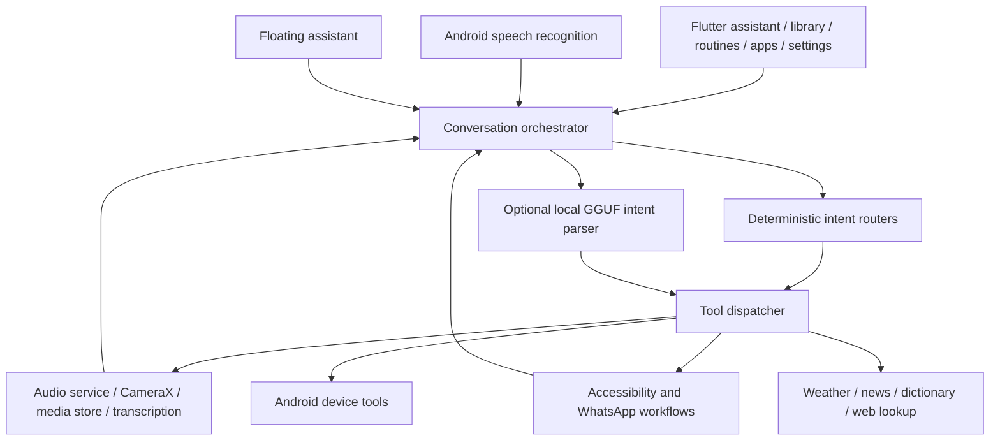

# CueUI

**An Android launcher and on-device AI assistant with agentic phone controls.**

Cue turns a spoken or typed intention into phone actions: capture a photo, record an idea, choose the right contact, share a file, or run a personal routine. Its original Flutter interface includes system, light, and dark appearance modes, a conversation timeline, media library, routines, app drawer, and settings.

| Light | Dark |
| --- | --- |
|  |  |

## Is it actually agentic AI?

Cue has bounded agentic behavior: it interprets intentions, executes tools, observes app UI, asks for missing information, remembers recent conversation context, and continues a workflow after a reply or permission grant. A command such as `take a selfie in 3 seconds then send this photo to Raihan on WhatsApp` combines capture, file tracking, app interaction, and recipient disambiguation.

The architecture is **rules first, optional local AI second**. A small GGUF model maps unfamiliar phrasing to an allowlisted tool with schema-constrained JSON. Most multi-step execution and recovery are explicit application workflows. Cue is not an unrestricted autonomous agent, a general visual reasoning model, or an open-ended AI planner. No cloud LLM or API key is required.

## Capabilities

| Area | Implemented behavior |
| --- | --- |
| Audio recorder | Foreground PCM WAV recording, pause/resume, named save, notification controls, playback, rename, deletion, and recovery of interrupted WAV files |
| Camera | Dedicated CameraX preview, automatic photo capture, up to 30-second countdown, front/back switching, and video recording with audio and stop/save controls |
| Media library | Private photos, videos, and recordings; search across titles and saved transcripts; preview/playback; sharing |
| WhatsApp text | Search and send; ask about multiple matching contacts; retain and edit the message while choosing |
| WhatsApp media | Android file sharing followed by recipient selection and preview/send automation; retain the exact attachment while choosing |
| WhatsApp voice messages | Experimental locked microphone gesture inside WhatsApp, recording-state checks, send, and discard |
| Dictation | Ask for a message, use the microphone to dictate it, then pass the text into messaging |
| Context | Recent-recipient pronouns, pending-message corrections, and choosing another recently offered contact |
| Transcription | On-device saved-WAV transcription on supported Android 13+ speech engines; saved transcripts are editable and searchable |
| Routines | Editable Bedtime, Morning, Focus, and custom routines combining brightness, Do Not Disturb, and optional alarm actions |
| Existing phone tools | Calls, SMS, notifications and inline replies, apps, navigation, screenshots, media controls, alarms, timers, calendar drafts, weather, news, and web lookup |

**Builds and simulated workflow tests do not establish real-device compatibility.** WhatsApp automation, OEM behavior, camera hardware, speech packs, and saved-audio recognition must be checked on the target phone. See [device testing](docs/DEVICE_TESTING.md).

## Try these commands

```text
start audio recording
pause recording
resume recording
stop and save as meeting notes
play the latest recording
stop playback
transcribe the latest recording

open camera
take a photo
take a selfie in 3 seconds
switch to back camera
start video recording
stop video
cancel countdown

take a photo then send this photo to Raihan on WhatsApp
send this recording to Sara on WhatsApp
send hi to Raihan on WhatsApp
change that to hello
use the other Raihan
send it to him
dictate a message to Sara

record a voice message to Raihan on WhatsApp
send voice note
cancel voice note

run bedtime routine
run morning routine
run routine Study
```

Select a recipient by tapping a choice, saying a full name, or replying `2` / `the second one`. Identical display names require a phone number rather than guessing. Media sharing by phone number depends on what WhatsApp exposes in its recipient picker. A correction after a message was sent creates a new draft; it does not undo the earlier send. Recent-recipient context is kept in memory and resets when the app restarts.

### Recording and microphone controls

Audio recordings use a microphone foreground service with a visible notification. The recorder can continue when you leave the launcher. Notification actions and the in-app recording bar pause/resume or stop/save it.

For a spoken command during a Cue audio recording, tap the assistant microphone: Cue temporarily pauses capture, releases the microphone to speech recognition, then restores the prior recording state. You can then say `stop and save as meeting notes`. This is push-to-talk, not always-listening wake-word detection.

Use the camera's typed command box, its controls, or the floating bubble for video stop/save. Video stops if the camera leaves the foreground. While WhatsApp itself owns the microphone for a voice message, use typed send/cancel commands or WhatsApp's controls. Cue suppresses spoken replies during recording to avoid recording its own response.

Saved audio shared as a file is a WhatsApp audio attachment. A native WhatsApp voice message uses the separate `record a voice message to ...` workflow; Cue does not relabel a file attachment as a voice message.

### Transcription support

Cue's recorder writes 16 kHz mono PCM WAV. The transcription path streams that saved audio to an installed **on-device** speech recognizer using Android 13's audio-source and segmented-session APIs. It requires a compatible recognizer and offline language data; support is not universal. Unsupported engines produce an error rather than a fabricated transcript. Video transcription and a bundled Whisper speech model are not included. Recordings longer than 30 minutes must be split before using this transcription path.

Android reference: [RecognizerIntent audio-source and segmented-session APIs](https://developer.android.com/reference/android/speech/RecognizerIntent). Camera implementation: [CameraX capture architecture](https://developer.android.com/media/camera/camerax/video-capture).

## Setup

Requirements:

- Flutter with Dart **3.11.5 or newer**, below Dart 4; this workspace uses Flutter **3.41.9**.
- Android SDK / platform 35, Java 17, and an Android phone or emulator with API 26+.
- Android 11+ for accessibility screenshots; Android 13+ and a compatible speech engine for file transcription.
- Internet access for package/native-library downloads, optional GGUF model downloads, weather, news, and web lookup.

```sh
flutter pub get
flutter analyze
flutter test
flutter run
```

Open **Settings** and enable access for the features you use. Camera and microphone are required for capture; Accessibility controls cross-app automation; overlay access enables the bubble; Contacts, Phone, SMS, and notification access enable the corresponding phone tools. Brightness and DND have separate system settings. Default Home is optional.

The optional local intent models are downloaded from their catalog in Settings. Model files are not committed to Git. Speech recognition prefers the device's on-device recognizer; if unavailable, ordinary voice commands fall back to the installed platform recognition service, whose offline/network behavior depends on the device. File transcription specifically requires the on-device service.

## Architecture



Key locations:

- `lib/orchestrator/cue_orchestrator.dart`: conversation state, follow-ups, corrections, confirmations, cancellation, and sequential execution.
- `lib/services/offline_intent_router.dart` and `extended_intent_router.dart`: supported command patterns.
- `lib/services/tool_dispatcher.dart`: native/web tools, sharing, and routines.
- `lib/services/media_service.dart` / `routine_service.dart`: library state and persisted routine definitions.
- `lib/services/nano_ai_service.dart`: local model discovery, downloads, and constrained intent parsing.
- `lib/services/whatsapp_automator.dart`: screen-based text, sharing, and voice-message workflows.
- `lib/ui/`: original themes and interface components.
- `android/app/src/main/kotlin/com/cueui/cueui_flutter/`: native camera, recorder, media storage, speech, device access, Accessibility, and overlay services.
- `test/`: routing, parsing, conversation, media state, routine failure handling, automation, and UI regression tests.

## Data and network behavior

- Captures and transcripts are stored in the app's private `files/cue_media` directory. Uninstalling the app removes them; export/share important recordings first.
- FileProvider exposes that media directory with temporary read grants for sharing. It does not expose the rest of app storage.
- Recordings are local files, not end-to-end encrypted by Cue. The manifest disables Android backup.
- Routine definitions, model selection, and the last weather city are stored locally.
- No cloud transcription service, telemetry SDK, or cloud LLM is configured in this project.
- Weather, news, and web questions send the relevant query to the services implemented in the source. Sending media to WhatsApp explicitly hands the selected file to WhatsApp.

## Validation and current limits

```sh
flutter analyze
flutter test
flutter build apk --debug
```

The debug APK is written to `build/app/outputs/flutter-apk/app-debug.apk`. UI smoke tests also render local previews under `build/ui-previews/`; preview fonts use local Windows fonts when available and fall back to the test font elsewhere.

- WhatsApp text, file-picker, and voice-message controls can change with app version, language, and screen layout. Matching considers currently exposed screen results, not an exhaustive WhatsApp contact database. An unrecognized screen stops the workflow for manual completion.
- “Submitted” means Cue activated WhatsApp's Send control; it does not establish network delivery or recipient read status.
- Camera controls are implemented with CameraX, but hardware use-case compatibility, recording interruption, storage pressure, and rotation need device testing.
- Routines run on demand, stop at the first failed action, and keep already completed changes. They are not scheduled background automations.
- The GGUF model performs intent extraction. It does not inspect images, transcribe speech, or perform unrestricted planning.
- Release builds currently use the existing debug signing configuration. Configure your own release signing before distributing a production build.

## Git and publishing

Git is initialized on `main`. Generated build output, local Android SDK settings, credentials, signing files, model files, and personal media directories are ignored. The Android Gradle wrapper is included for reproducible checkouts.

To connect a repository when ready:

```sh
git remote add origin <your-repository-url>
git push -u origin main
```

No remote is configured or pushed by this setup. Choose a project license before public distribution.
