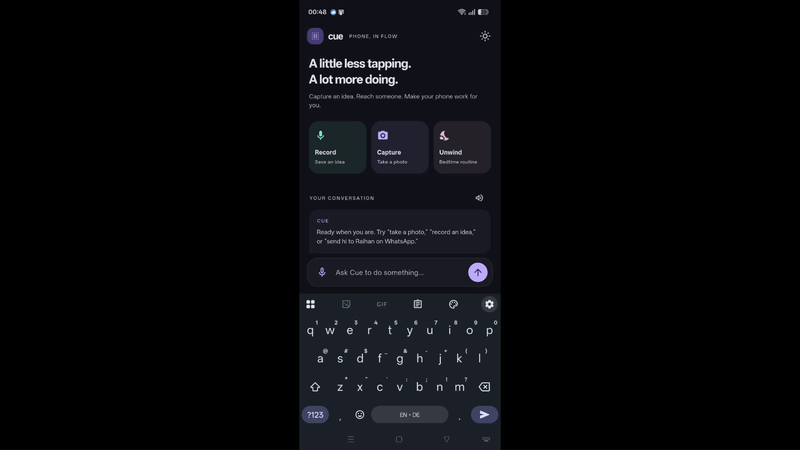
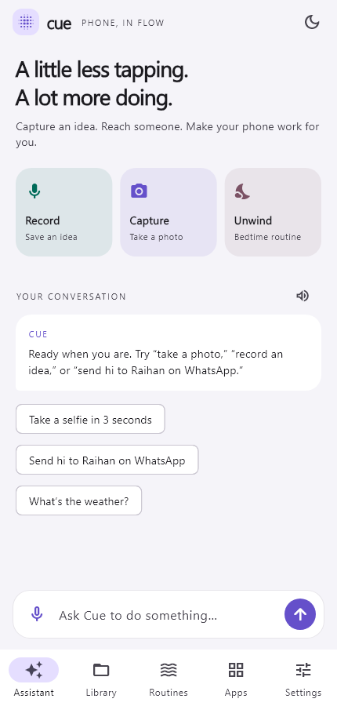
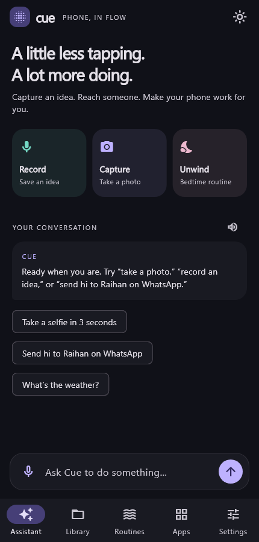
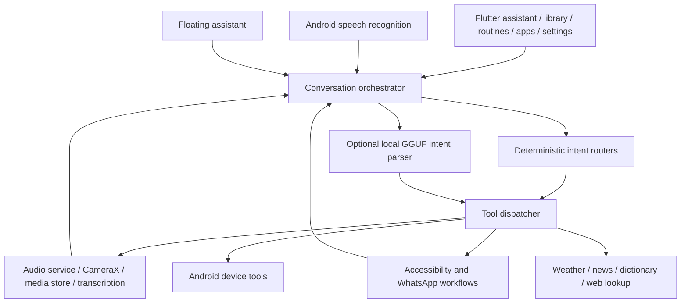

# CueUI

**A local-first Android launcher project that turns everyday intentions into phone actions.**

Cue turns a spoken or typed intention into phone actions: capture a photo, record an idea, choose the right contact, share a file, or run a personal routine. Its original Flutter interface includes system, light, and dark appearance modes, a conversation timeline, media library, routines, app drawer, and settings.

**Status: working prototype under active development.** The demo shows local AI triggering a phone command; it does not establish that every feature works on every phone. The next interface milestone is a minimalist, launcher-first home screen with an on-demand command bar and compact results instead of a chatbot-style timeline. That redesign is planned, not yet implemented.

## The problem

A simple intention such as “send this photo to Raihan” can require opening an app, finding a file, navigating a share screen, choosing the right contact, and checking the result. Each app has its own layout and interaction rules.

For someone who finds small controls, visual navigation, typing, or remembering app-specific steps difficult, those interactions can become a barrier. Depending on a remote AI service for every command also adds a network requirement and can mean sending the command to another provider for processing.

## CueUI's approach

Cue aims to put the intention first: **say or type what you want to do, then let the phone handle the supported steps.**

- **Local command understanding:** familiar commands use deterministic rules; unfamiliar phrasing can use a small GGUF model running on the phone. There is no cloud LLM requirement for this path.
- **Actions across apps:** native Android tools and screen-based automation connect capture, recordings, messaging, and device settings.
- **Clarification when needed:** ask which contact the user means instead of deliberately choosing the first matching name; retain the message or attachment while the user answers.
- **Less repeated navigation:** recent-recipient context and editable routines connect related actions.
- **A launcher-first direction:** apps remain the home-screen focus, with commands available when needed. The current prototype UI is shown below; the simpler launcher is the next design milestone.

Local processing reduces the need to send commands to a cloud model. It does **not** make messaging services, web lookups, or all speech recognition work without a network. See [internet dependency](#what-needs-an-internet-connection) and [data handling](#data-and-network-behavior).

## Who could benefit?

CueUI is intended for people who want fewer steps between an intention and an action, including:

- **Older adults** who prefer plain-language tasks over navigating unfamiliar menus.
- **Blind and low-vision users** who could benefit from voice input, spoken results, and fewer visually dependent steps.
- **People with limited dexterity** who may find repeated tapping or typing difficult.
- **Anyone seeking a simpler launcher** and shortcuts for everyday phone tasks.

These are intended use cases, not validated accessibility claims. Voice input and spoken replies exist, but independent use with TalkBack, Switch Access, larger text, and assistive devices has not been established. CueUI's Accessibility service controls other apps; that alone does not make CueUI's own interface accessible. Some video and WhatsApp voice-recording actions currently require typed or on-screen controls.

Testing with blind, low-vision, and older participants is a priority before describing the app as ready for those audiences. The plan includes meaningful labels, predictable focus order, reachable controls, clear spoken choices, and recoverable mistakes, following [Android's accessibility testing guidance](https://developer.android.com/guide/topics/ui/accessibility/testing).

## Demo



This demo runs **Qwen3 0.6B locally on a OnePlus Nord 3 5G**, with no cloud LLM. It took approximately **13 seconds from command submission to triggering the command**. This is the observed demo timing, not the time to complete every action; timing varies with the device and model state.

### Demo hardware

| Component | Demo device |
| --- | --- |
| Phone | OnePlus Nord 3 5G |
| Chipset / CPU | MediaTek Dimensity 9000 |
| GPU | Arm Mali-G710 MC10 |
| RAM | **8 GB LPDDR5X** |
| Storage | **128 GB UFS 3.1** |
| Display | 6.74-inch AMOLED, 2772 × 1240, up to 120 Hz |
| Local model | Qwen3 0.6B |
| Observed command-trigger time | Approximately **13 seconds** |

The demo used the **8 GB / 128 GB variant**, confirmed by the device owner. Hardware specifications are from [OnePlus's official Nord 3 5G specifications](https://www.oneplus.com/de/nord-3-5g/specs). The installed Android/OxygenOS version and available RAM during the demo were not recorded.

## Appearance

| Light | Dark |
| --- | --- |
|  |  |

## Is it actually agentic AI?

Cue has bounded agentic behavior: it interprets intentions, executes tools, observes app UI, asks for missing information, remembers recent conversation context, and continues a workflow after a reply or permission grant. A command such as `take a selfie in 3 seconds then send this photo to Raihan on WhatsApp` combines capture, file tracking, app interaction, and recipient disambiguation.

The architecture is **rules first, optional local AI second**. A small GGUF model maps unfamiliar phrasing to an allowlisted tool with schema-constrained JSON. Most multi-step execution and recovery are explicit application workflows. Cue is not an unrestricted autonomous agent, a general visual reasoning model, or an open-ended AI planner. No cloud LLM or API key is required.

There is one application orchestrator with tools, not a collection of independently reasoning agents. The most accurate positioning today is **“a local-first AI launcher with agentic phone controls.”** If no local model is loaded, supported rule-based commands still work; they do not involve AI inference.

## Capabilities

| Area | Implemented behavior |
| --- | --- |
| Audio recorder | Foreground PCM WAV recording, pause/resume, named save, notification controls, playback, rename, deletion, and recovery of interrupted WAV files |
| Camera | Dedicated CameraX preview, automatic photo capture, up to 30-second countdown, front/back switching, and video recording with audio and stop/save controls |
| Media library | Private photos, videos, and recordings; search across titles and saved transcripts; preview/playback; sharing |
| WhatsApp text | Search and send; ask about multiple matching contacts; retain and edit the message while choosing |
| WhatsApp media | Android file sharing followed by recipient selection and preview/send automation; retain the exact attachment while choosing |
| WhatsApp voice messages | Experimental locked microphone gesture inside WhatsApp, recording-state checks, send, and discard |
| Dictation | Ask for a message, use the microphone to dictate it, then pass the text into messaging |
| Context | Recent-recipient pronouns, pending-message corrections, and choosing another recently offered contact |
| Transcription | On-device saved-WAV transcription on supported Android 13+ speech engines; saved transcripts are editable and searchable |
| Routines | Editable Bedtime, Morning, Focus, and custom routines combining brightness, Do Not Disturb, and optional alarm actions |
| Existing phone tools | Calls, SMS, notifications and inline replies, apps, navigation, screenshots, media controls, alarms, timers, calendar drafts, weather, news, and web lookup |

**Builds and simulated workflow tests do not establish real-device compatibility.** WhatsApp automation, OEM behavior, camera hardware, speech packs, and saved-audio recognition must be checked on the target phone. See [device testing](docs/DEVICE_TESTING.md).

## Try these commands

```text
start audio recording
pause recording
resume recording
stop and save as meeting notes
play the latest recording
stop playback
transcribe the latest recording

open camera
take a photo
take a selfie in 3 seconds
switch to back camera
start video recording
stop video
cancel countdown

take a photo then send this photo to Raihan on WhatsApp
send this recording to Sara on WhatsApp
send hi to Raihan on WhatsApp
change that to hello
use the other Raihan
send it to him
dictate a message to Sara

record a voice message to Raihan on WhatsApp
send voice note
cancel voice note

run bedtime routine
run morning routine
run routine Study
```

Select a recipient by tapping a choice, saying a full name, or replying `2` / `the second one`. Identical display names require a phone number rather than guessing. Media sharing by phone number depends on what WhatsApp exposes in its recipient picker. A correction after a message was sent creates a new draft; it does not undo the earlier send. Recent-recipient context is kept in memory and resets when the app restarts.

### Recording and microphone controls

Audio recordings use a microphone foreground service with a visible notification. The recorder can continue when you leave the launcher. Notification actions and the in-app recording bar pause/resume or stop/save it.

For a spoken command during a Cue audio recording, tap the assistant microphone: Cue temporarily pauses capture, releases the microphone to speech recognition, then restores the prior recording state. You can then say `stop and save as meeting notes`. This is push-to-talk, not always-listening wake-word detection.

Use the camera's typed command box, its controls, or the floating bubble for video stop/save. Video stops if the camera leaves the foreground. While WhatsApp itself owns the microphone for a voice message, use typed send/cancel commands or WhatsApp's controls. Cue suppresses spoken replies during recording to avoid recording its own response.

Saved audio shared as a file is a WhatsApp audio attachment. A native WhatsApp voice message uses the separate `record a voice message to ...` workflow; Cue does not relabel a file attachment as a voice message.

### Transcription support

Cue's recorder writes 16 kHz mono PCM WAV. The transcription path streams that saved audio to an installed **on-device** speech recognizer using Android 13's audio-source and segmented-session APIs. It requires a compatible recognizer and offline language data; support is not universal. Unsupported engines produce an error rather than a fabricated transcript. Video transcription and a bundled Whisper speech model are not included. Recordings longer than 30 minutes must be split before using this transcription path.

Android reference: [RecognizerIntent audio-source and segmented-session APIs](https://developer.android.com/reference/android/speech/RecognizerIntent). Camera implementation: [CameraX capture architecture](https://developer.android.com/media/camera/camerax/video-capture).

## Setup

Requirements:

- Flutter with Dart **3.11.5 or newer**, below Dart 4; this workspace uses Flutter **3.41.9**.
- Android SDK / platform 35, Java 17, and an Android phone or emulator with API 26+.
- Android 11+ for accessibility screenshots; Android 13+ and a compatible speech engine for file transcription.
- Internet access for package/native-library downloads, optional GGUF model downloads, weather, news, and web lookup.

```sh
flutter pub get
flutter analyze
flutter test
flutter run
```

Open **Settings** and enable access for the features you use. Camera and microphone are required for capture; Accessibility controls cross-app automation; overlay access enables the bubble; Contacts, Phone, SMS, and notification access enable the corresponding phone tools. Brightness and DND have separate system settings. Default Home is optional.

The optional local intent models are downloaded from their catalog in Settings. Model files are not committed to Git. Speech recognition prefers the device's on-device recognizer; if unavailable, ordinary voice commands fall back to the installed platform recognition service, whose offline/network behavior depends on the device. File transcription specifically requires the on-device service.

## Architecture



Key locations:

- `lib/orchestrator/cue_orchestrator.dart`: conversation state, follow-ups, corrections, confirmations, cancellation, and sequential execution.
- `lib/services/offline_intent_router.dart` and `extended_intent_router.dart`: supported command patterns.
- `lib/services/tool_dispatcher.dart`: native/web tools, sharing, and routines.
- `lib/services/media_service.dart` / `routine_service.dart`: library state and persisted routine definitions.
- `lib/services/nano_ai_service.dart`: local model discovery, downloads, and constrained intent parsing.
- `lib/services/whatsapp_automator.dart`: screen-based text, sharing, and voice-message workflows.
- `lib/ui/`: original themes and interface components.
- `android/app/src/main/kotlin/com/cueui/cueui_flutter/`: native camera, recorder, media storage, speech, device access, Accessibility, and overlay services.
- `test/`: routing, parsing, conversation, media state, routine failure handling, automation, and UI regression tests.

## What needs an internet connection?

| Feature | Current dependency |
| --- | --- |
| Rule-based commands and local GGUF inference | Can run without internet once the model is available locally |
| App launching, photos, audio recording, playback, and local routine actions | Local operations; permissions, hardware, and target-app support still apply |
| Voice commands | Uses on-device recognition when available; otherwise falls back to the installed speech service, which may use the network |
| Saved-recording transcription | Requires a supported on-device speech engine and installed language data; initial language-data installation may need internet |
| WhatsApp, YouTube, Spotify, and other connected apps | Command routing may be local, but the destination service retains its own network requirements |
| Calls and SMS | Depend on the phone's carrier/service connection; local command recognition does not remove that requirement |
| Weather, news, and web answers | Internet required; lookup queries are sent to external information services |
| Model installation and updates | Catalog downloads require internet; existing readable GGUF files can also be discovered locally |

“Local AI” describes where the intent model runs. It is not a claim that the entire phone or every workflow is offline. Android also notes that speech-recognition implementations may send audio to remote services; Cue's ordinary voice-command fallback must be considered when evaluating privacy. [Android SpeechRecognizer reference](https://developer.android.com/reference/android/speech/SpeechRecognizer)

## Data and network behavior

The aim is to minimize unnecessary data transfers. The following describes the current code, **not a guarantee of zero data leakage or an independent security audit**.

| Data or action | Current handling |
| --- | --- |
| Commands routed to the local model | Processed by the GGUF engine on the phone; no cloud LLM endpoint is configured |
| Ordinary voice input | Passed to the selected Android recognition service; network/privacy behavior depends on the on-device or fallback service used |
| Photos, videos, saved audio, and transcripts | Stored in private app files under `files/cue_media`; no automatic cloud upload is implemented |
| Sharing a file | Gives the selected destination app temporary read access through FileProvider; WhatsApp then handles its own transmission |
| Weather and web queries | Sends city/forecast coordinates, search terms, or question text to the relevant external service |
| Model downloads | Requests model files from the catalog's Hugging Face URLs |
| Conversation and notification context | Conversation entries and a limited notification buffer are held in memory; recent-recipient context resets on app restart |
| Local settings | Routines, model selection, appearance, and the last weather city are stored locally |

Important boundaries:

- The current question fallback can send an unrecognized question to web lookup. A strict offline mode and explicit network-use controls are **planned**, not implemented.
- Camera, microphone, Contacts, SMS, notification access, and Accessibility expose sensitive capabilities. Enable only the access needed for the actions you use. Feature-by-feature permission onboarding still needs improvement.
- Current AI diagnostic logging can include command text. Logging must be reviewed and redacted before production distribution or sharing debug logs.
- Private app storage is not application-level encrypted storage. Android backup is disabled, but that does not establish that all data is protected under every device or compromise scenario.
- No cloud transcription service, telemetry SDK, or cloud LLM is configured in this project. That does not describe the behavior of Android speech providers, destination apps, browsers, or the operating system.
- Uninstalling the app removes its private media. Export important files first. Broader retention, export, and clear-all controls are roadmap work.

Privacy work will include a reviewed data-flow inventory, network-behavior tests, logging controls, model-download integrity checks, and a security review. See the [development roadmap](docs/ROADMAP.md).

## Under development and next priorities

Existing features are implemented to different levels of maturity. The items below are **planned improvements or hardening work**, not additional capabilities already delivered.

| Priority | Work | Intended outcome |
| --- | --- | --- |
| P0 | Minimalist launcher redesign | Apps and favorites first; a button reveals the command bar; compact results instead of a conversation feed |
| P0 | Accessibility and user testing | TalkBack/Switch Access workflows, clear labels and spoken choices, larger controls, and trials with intended users |
| P0 | Privacy and offline controls | Explicit control over web fallback and speech-provider use, redacted diagnostics, clearer permissions and retention |
| P0 | Messaging reliability | More robust recipient identification, fresh screen checks, consistent review of consequential actions, and recovery from changed app UI |
| P1 | Local AI performance | Measure cold/warm latency, memory, battery use, and task success across phones; reduce the observed 13-second demo latency |
| P1 | Speech and transcription | Broader offline-engine support, language/accent testing, clearer microphone handoff and failure recovery |
| P1 | Camera/recorder compatibility | Real-device interruption, rotation, storage-pressure, and repeated-capture testing |
| P1 | Agentic execution and release readiness | Better bounded planning/recovery, traceable outcomes, production signing, and repeatable integration tests |

The [roadmap](docs/ROADMAP.md) defines concrete completion criteria. The [phone-testing guide](docs/DEVICE_TESTING.md) distinguishes code/test coverage from validation on real devices. The demo is one observed run on the documented OnePlus device, not a full compatibility or accessibility study.

## Validation and current limits

```sh
flutter analyze
flutter test
flutter build apk --debug
```

The debug APK is written to `build/app/outputs/flutter-apk/app-debug.apk`. UI smoke tests also render local previews under `build/ui-previews/`; preview fonts use local Windows fonts when available and fall back to the test font elsewhere.

- WhatsApp text, file-picker, and voice-message controls can change with app version, language, and screen layout. Matching considers currently exposed screen results, not an exhaustive WhatsApp contact database. An unrecognized screen stops the workflow for manual completion.
- “Submitted” means Cue activated WhatsApp's Send control; it does not establish network delivery or recipient read status.
- Camera controls are implemented with CameraX, but hardware use-case compatibility, recording interruption, storage pressure, and rotation need device testing.
- Routines run on demand, stop at the first failed action, and keep already completed changes. They are not scheduled background automations.
- The GGUF model performs intent extraction. It does not inspect images, transcribe speech, or perform unrestricted planning.
- Release builds currently use the existing debug signing configuration. Configure your own release signing before distributing a production build.

## Git and publishing

Git is initialized on `main`. Generated build output, local Android SDK settings, credentials, signing files, model files, and personal media directories are ignored. The Android Gradle wrapper is included for reproducible checkouts.

Repository: [raihhann/CueUI](https://github.com/raihhann/CueUI).

To publish local changes when ready:

```sh
git add README.md docs/
git commit -m "Update project documentation"
git push -u origin main
```

The connected remote is `origin`. Documentation edits do not automatically publish themselves; review the commit before pushing. Choose a project license before public distribution.
